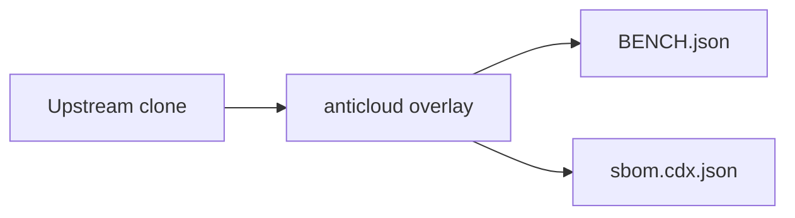

# VSCODE — Anticloud overlay

 

Upstream: UNKNOWN
## Benchmarks
Benchmarks from BENCH.json: {"schema": "anticloud.tier-bench/1", "project": "VSCODE", "source": {"repo_path": "E:\\fenta\\Downloads\\The Anticloud\\ANTICLOUD_REPOS\\SOFTWARE_DEVELOPMENT\\VSCODE\\UPSTREAM_CLONE", "git": {"head": "", "url": "https://github.com/the-anticloud/OPENMRS_CORE.git", "branch": "master", "committed_at": "2026-09-29T11:06:59+04:00"}}, "metrics": {"files_total": 2048, "source_files_scanned": 1493, "lines_of_code": 427294, "languages": {".ts": 1163, ".tsx": 228, ".snap": 187, ".rs": 84, ".txt": 77, "(none)"

Withdrawn claims: anything not in BENCH.json is unmeasured.

## Architecture

## Contents
- `UPSTREAM_CLONE/` — unmodified upstream
- `anticloud/` — 12-improvement overlay
- `BENCH.json`, `sbom.cdx.json` — measured outputs

## Provenance
Tree SHA3-256: 9ed9b42dd3f967500c4c837e91cf214a972ef528d55589bbc58bcca081c07e70. Chain head: see seal step.

## Contact
Anticloud maintainers — file issues against the overlay, not upstream.
